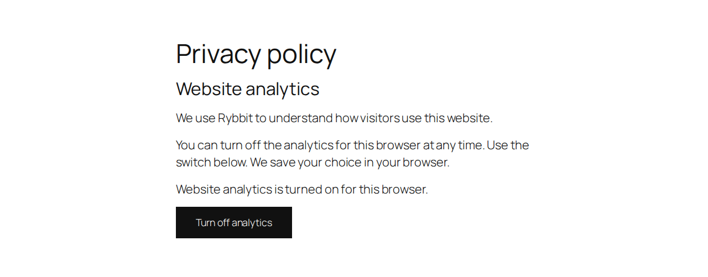
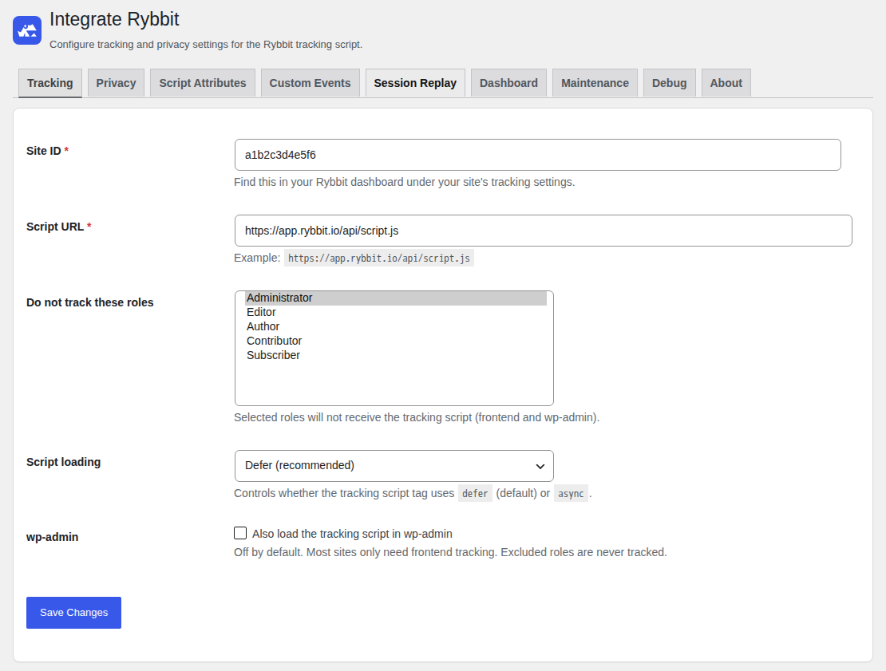
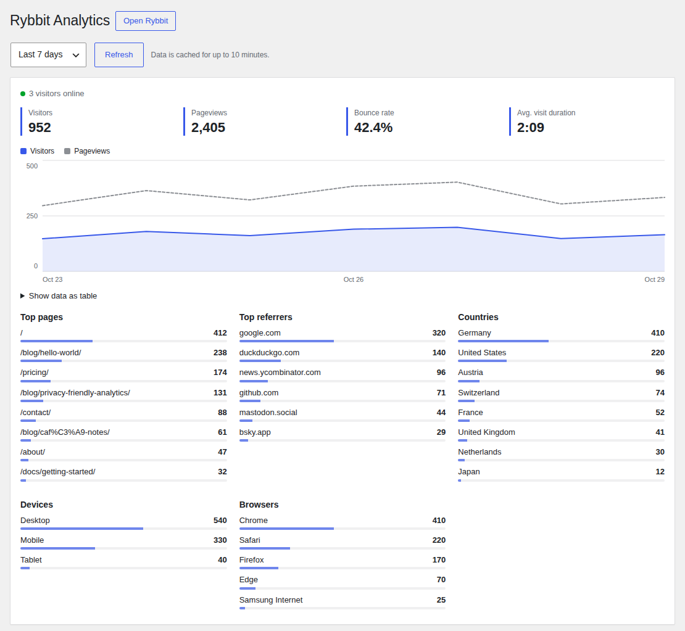

# Integrate Rybbit

[](https://wordpress.org/plugins/integrate-rybbit/)
[](https://wordpress.org/plugins/integrate-rybbit/)
[](https://wordpress.org/plugins/integrate-rybbit/)
[](https://github.com/maki-it/rybbit-wordpress-plugin/releases/latest)
[](https://github.com/maki-it/rybbit-wordpress-plugin/actions/workflows/ci.yaml)

WordPress plugin to add and manage the [Rybbit](https://rybbit.com) tracking script on your sites.
Rybbit is an open source and privacy-focused web analytics platform.

Get the plugin from the [WordPress.org plugin directory](https://wordpress.org/plugins/integrate-rybbit/).

## Features

- Works with Rybbit Cloud and with self-hosted Rybbit instances.
- Analytics dashboard in wp-admin (optional, needs a Rybbit API key): a widget on the WordPress dashboard and a page at
  `Dashboard` > `Rybbit Analytics`. It shows visitors, pageviews, bounce rate, visit duration, visitors online,
  a chart and the top pages, referrers, countries, devices and browsers.
- Do not track selected user roles. Administrators are excluded by default.
- Optional tracking inside wp-admin. It is off by default.
- Load the script with `defer` (recommended) or `async`.
- Skip patterns and mask patterns for URL paths, with wildcards (`*`, `**`) and regular expressions (`re:` prefix).
- Add a custom tag to all events.
- Optional user identification for logged-in users, in pseudonymized or full mode.
  User ID strategies: WordPress scoped ID, keyed hash (HMAC), user ID, login, email or a user meta field.
- Session replay privacy settings: block, ignore and mask elements, mask inputs, sampling and DOM slimming.
- Custom events: send an event to Rybbit when a visitor clicks an element. You set a CSS selector, an event name and
  optional properties on the `Custom Events` tab. You do not need to write JavaScript.
- Debug tab with the effective settings and the generated script attributes.
- Opt-out for visitors: the shortcode `[rybbit_optout]` and the block `Rybbit Opt-out` show a button. A visitor can
  turn the analytics off and on again. See [Visitor opt-out](#visitor-opt-out).
- Developer filters: `integrate_rybbit_should_track`, `integrate_rybbit_script_attributes`,
  `integrate_rybbit_identify_user_id`, `integrate_rybbit_identify_traits`, `integrate_rybbit_custom_events`,
  `integrate_rybbit_dashboard_capability`, `integrate_rybbit_api_http_args` and `integrate_rybbit_optout_html`.
  See [readme.txt](integrate-rybbit/readme.txt) for details and an example.

## Requirements

- WordPress 6.5 or newer
- PHP 7.4 or newer

## Installation

The recommended way is the WordPress.org plugin directory:

1. In wp-admin, go to `Plugins` > `Add New`.
2. Search for "Integrate Rybbit", then click `Install Now` and `Activate`.

To install a release from GitHub:

1. Download `integrate-rybbit.zip` from the [latest release](https://github.com/maki-it/rybbit-wordpress-plugin/releases/latest).
2. In wp-admin, go to `Plugins` > `Add New` > `Upload Plugin`.
3. Select the zip file, click `Install Now` and then `Activate Plugin`.

## Configuration

1. Go to `Settings` > `Integrate Rybbit`.
2. Enter your Rybbit Site ID.
3. If you host Rybbit yourself, set the Script URL to `https://your-rybbit-domain/api/script.js`.
4. Save the settings.

All other settings are optional.

### Analytics dashboard

The dashboard reads the numbers from the Rybbit API. It needs an API key.

1. In Rybbit, go to `Organization settings` > `API keys` and create a key.
2. In WordPress, go to `Settings` > `Integrate Rybbit` > `Dashboard`, enter the key and save.
3. Click `Test connection`. After this, the widget and the page `Dashboard` > `Rybbit Analytics` are available.

Notes:

- Rybbit Cloud offers API keys on the Standard plan and above. Self-hosted instances have no such limit.
  The tracking works on every plan.
- The key only needs read access to `Analytics`. A key without restrictions also works. If you restrict the key to
  some resources, select `Analytics` with `read`. Otherwise Rybbit answers with `403` and the plugin shows the
  missing permission.
- The "Open Rybbit" button needs the number of the site (for example `/29`). The plugin reads it from the site
  settings, which needs `Sites` with `read`. Without it, the button opens the start page of Rybbit.
- You can define the key in `wp-config.php` instead of the database. This key replaces the saved key:
  `define( 'INTEGRATE_RYBBIT_API_KEY', 'your-key' );`
- The key stays on the server. The browser only talks to a REST route of your site (`integrate-rybbit/v1/stats`).
- The plugin caches the API answers (10 minutes by default) to save API requests.
- Only users with the capability `manage_options` see the dashboard. Change it with the filter `integrate_rybbit_dashboard_capability`.

### Visitor opt-out

Visitors can turn the analytics off for their browser. Add the shortcode to a page, for example your privacy policy:

```
[rybbit_optout]
```

In the block editor, use the block `Rybbit Opt-out`. The block has a `Texts` panel in the sidebar.

| Attribute        | Description                                    |
|------------------|------------------------------------------------|
| `optout_label`   | Text of the button that turns the analytics off. |
| `optin_label`    | Text of the button that turns the analytics on.  |
| `tracked_text`   | Status text while the analytics is on.           |
| `untracked_text` | Status text while the analytics is off.          |
| `class`          | Extra CSS classes for the wrapper element.       |

Example:

```
[rybbit_optout optout_label="Stop tracking me" tracked_text="We count your visit." class="my-style"]
```

Notes:

- The choice is saved in the local storage of the browser under the key `disable-rybbit`. It applies to this website
  and this browser only. A visitor who clears the browser data also clears the opt-out.
- The choice takes effect on the next page load. The Rybbit script reads it once at start.
- The opt-out needs the Rybbit script v1.1.0 or newer. Old self-hosted instances may ignore it.
- If you set `data-namespace` with the filter `integrate_rybbit_script_attributes`, the key is `disable-<namespace>`.
  The plugin uses the same namespace automatically.
- Without a Site ID, only administrators see a notice instead of the button.
- Use the filter `integrate_rybbit_optout_html` to change the HTML. The second argument is the array of texts.



## Screenshots




More screenshots are in the [assets](assets/) folder.

## Migration from Rybbit Analytics

If you previously used this plugin under the name "Rybbit Analytics", you can safely uninstall that version after activating this new plugin.
You need to re-enter your Site ID in the new plugin settings, as the configuration does not carry over automatically.

## Development

All PHP and WordPress tools run in Docker. You only need Docker (with Compose), `make` and `zip` on your computer.

```sh
make help          # Show all targets.
make check         # Run all checks: lint, phpcs and plugin-check.
make dev           # Start WordPress with the plugin active.
make down          # Stop WordPress.
```

| Target              | Description                                                                          |
|---------------------|--------------------------------------------------------------------------------------|
| `make check`        | Runs `lint`, `phpcs` and `plugin-check`. CI runs the same targets.                   |
| `make lint`         | Checks the PHP syntax with PHP 7.4 to 8.5. Use `PHP_VERSIONS="8.4"` for one version. |
| `make phpcs`        | Checks the coding standards (WordPress Coding Standards and PHPCompatibilityWP).     |
| `make phpcbf`       | Fixes coding standard issues that can be fixed automatically.                        |
| `make dev`          | Starts WordPress at http://localhost:8080 with the plugin active (`admin` / `admin`). |
| `make plugin-check` | Runs the official [Plugin Check](https://wordpress.org/plugins/plugin-check/).       |
| `make test-dashboard` | Tests the analytics dashboard backend against the mock Rybbit API.                 |
| `make test-optout`  | Tests the opt-out shortcode and block, with a headless browser in Docker.           |
| `make pot`          | Generates `build/integrate-rybbit.pot` to review the translatable strings.          |
| `make translations` | Compiles the `.po` files in `integrate-rybbit/languages/` to `.mo` and JSON files.   |
| `make screenshots`  | Retakes the screenshots in `assets/` with a headless browser in Docker.             |
| `make logs`         | Shows the WordPress debug log.                                                       |
| `make down`         | Stops the development environment.                                                   |
| `make clean`        | Stops the development environment and deletes all data and build files.             |
| `make zip`          | Builds `integrate-rybbit.zip` for a manual upload.                                   |

Notes:

- The plugin folder is mounted read-only into the WordPress container. Changes are visible after a page reload.
- Use `WP_PORT=8081 make dev` if port 8080 is in use.
- Use `WP_IMAGE_TAG=6.5 make dev` to test with an older WordPress version.
  Start with `make clean` when you change the WordPress version.
- To update a translation: run `make pot`, merge the new strings with
  `msgmerge --no-fuzzy-matching --backup=none -U integrate-rybbit/languages/integrate-rybbit-de_DE.po build/integrate-rybbit.pot`,
  translate the new entries and run `make translations`. Commit the `.po`, `.mo` and `.json` files.
- `make screenshots` overwrites the plugin settings of the development site with example values.
- `make dev` also starts a mock of the Rybbit API (`tools/mock-rybbit`) with fixed demo data
  and connects the development site to it (API key `demo-key`). It is available at http://localhost:3001.
  These keys trigger errors: `bad-key` (401), `forbidden-key` (403) and `slow-key` (429).
- The settings are stored with the option prefix `rybbit_`.
  The plugin migrates old settings on update (option `integrate_rybbit_db_version`).

### Project structure

```
integrate-rybbit/        The plugin. Only this folder is deployed to WordPress.org.
assets/                  Icons and screenshots for WordPress.org.
tools/                   Docker setup for the checks and the development environment.
tools/mock-rybbit/       Mock of the Rybbit Stats API for the dashboard tests and the screenshots.
tools/tests/             Tests that run inside the development WordPress.
phpcs.xml.dist           PHPCS rules.
.github/workflows/       CI and release workflows.
```

## Release process

1. Make sure that `Tested up to` in [readme.txt](integrate-rybbit/readme.txt) is the current WordPress version.
   Plugin Check fails when a new major WordPress version is available and this value is older.
2. Publish a GitHub release with a new tag `vX.Y.Z`. The release notes become the changelog on WordPress.org.
3. The [release workflow](.github/workflows/release.yaml) does these steps:
   - Sets the version in the plugin header, the `INTEGRATE_RYBBIT_VERSION` constant and the `Stable tag`.
   - Writes the notes of the last 10 GitHub releases into the changelog of `readme.txt`.
   - Runs all checks.
   - Deploys the plugin and the assets to WordPress.org.
   - Attaches `integrate-rybbit.zip` to the GitHub release.

Pre-release tags (for example `v1.8.0-rc.1`) are not deployed to WordPress.org. Mark these releases as pre-release on GitHub.

The version in the repository is always `0.0.0`. Do not change it manually.

## Legal

This is a free and open-source WordPress plugin developed independently for integration with Rybbit
and licensed under the [GNU General Public License v3 or later](LICENSE).

The use of the Rybbit name and logo in this plugin has been explicitly approved by the owner of Rybbit.
All Rybbit trademarks, logos, and brand assets remain the property of their respective owner.

This plugin is not an official Rybbit product and is not otherwise affiliated with or endorsed by Rybbit.
